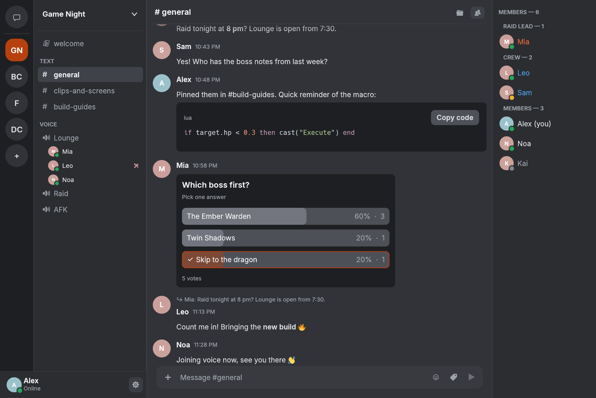
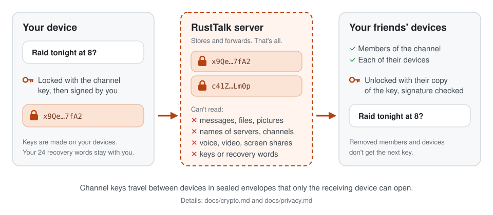

<p align="center">
  
</p>

<h1 align="center">RustTalk</h1>

<p align="center">
  <b>Private, self-hosted voice, video and chat for friends and small communities.</b><br>
  Everything you write or name is encrypted on your device. Servers only store and forward ciphertext.
</p>

<p align="center">
  <a href="https://github.com/rusttalkcrew/rusttalk-next/releases"></a>
  <a href="LICENSE"></a>
  
  
  
</p>

> [!WARNING]
> **RustTalk is in early development and changes every day.** Expect bugs,
> missing pieces and the odd update that older apps must install before they
> can connect again. The encryption has not had an independent security audit
> yet. Use it with friends, and don't rely on it where a mistake would really
> hurt.

<p align="center">
  <picture>
    <source media="(prefers-color-scheme: dark)" srcset="docs/images/app-dark.png">
    <source media="(prefers-color-scheme: light)" srcset="docs/images/app-light.png">
    
  </picture>
  <br>
  <sub>Demo content. RustTalk still changes, so the app may look a bit different.</sub>
</p>

## Why RustTalk?

- **Your server, your rules.** Run your own server with one Docker Compose
  file, or join one of the official ones.
- **The server can't read along.** Messages, files, pictures, names, topics,
  avatars and calls are end-to-end encrypted. See
  [How the encryption works](#how-the-encryption-works).
- **No email, no phone number.** You are 24 recovery words. Write them down
  and you can bring every device back.
- **No telemetry.** No analytics, no crash reports, no tracking. Every
  connection the app makes is listed in
  [docs/privacy.md](docs/privacy.md#outbound-connections).
- **Built for gaming nights.** Low-latency voice, 60 fps screen sharing, sound
  per app, remote control and a shared terminal.

## Features

<table>
<tr><td valign="top" width="50%">

**💬 Chat**
- Text channels and direct messages, with replies, edits and mentions
- Markdown and highlighted code
- Polls, pokes with a short note, inline GIFs and WebP
- Colour emoji plus custom server emoji and stickers, importable as a `.zip`
- Pictures and files by paste or drag and drop, and a Files list per channel
- Link previews for YouTube, Spotify, GitHub, Wikipedia and Reddit, made on
  your device (other sites only when you allow it)
- Page channels: one Markdown page with pictures, kept by the editors
- Unread marks, desktop notifications and per-channel settings

</td><td valign="top" width="50%">

**🎙️ Voice and video**
- Voice channels with push-to-talk or voice activation
- AI noise removal (DeepFilterNet) and automatic sensitivity
- Camera and screen or window sharing at a real 60 fps
- Share the sound of single apps or the whole system
- An audio mixer per person: voice, shared apps and stream sound
- Call stage with focus, bubbles, presentation mode and split layouts
- Let a viewer control your shared screen, with your permission
- Share a terminal, read-only or with typing allowed
- Global shortcuts for mute, deafen, push-to-talk and sharing

</td></tr>
<tr><td valign="top">

**🏰 Servers and communities**
- Several servers at once, with categories and channels you drag into place
- Roles with colours and permissions, kick, ban and an audit log
- Voice moderation: mute for everyone, move or remove from voice
- Invite links that show as cards in chat
- Friends, and DMs over any server you share
- Optional public server directory to find open servers
- Presence: online, away or invisible, and hide when offline

</td><td valign="top">

**🔐 Privacy and devices**
- One identity from 24 recovery words, no email or phone number
- Settings, friends and server list synced between your devices, encrypted
- Remove a lost device with your recovery words; it gets no new keys
- Keys in the system keychain, or in a password-protected file
- Signed self-updates on Windows, Linux and macOS
- The app in English, German, Dutch and Japanese
- Themes, accent colours and a "What's new" page after each update

</td></tr>
</table>

Full history: [CHANGELOG.md](CHANGELOG.md).

## How the encryption works

<p align="center">
  
</p>

In plain words:

1. **You are your recovery words.** The first time you start RustTalk it makes
   24 words. They create your personal key, which is your identity. The words
   are never stored, not even on your own device.
2. **Every device gets its own keys.** Your personal key signs a certificate
   for each device, so friends can check that a device really belongs to you.
   Lost a device? Remove it with your recovery words.
3. **Every server and channel has its own key.** Your app makes these keys
   itself. It hands them to the devices of everyone allowed in, each in a
   sealed envelope that only that device can open (HPKE, RFC 9180).
4. **Everything is locked before it leaves your device.** Messages, files,
   pictures, and the names of servers, channels and roles, topics, avatars and
   emoji are encrypted with XChaCha20-Poly1305 and signed with your device key.
   Voice, video and screen shares are encrypted frame by frame with a key made
   from the voice channel's key.
5. **Leaving locks people out.** When someone is kicked or banned, or a device
   is removed, the channel gets a new key that they don't receive. They keep
   only what they already saw.

**What the server does see:** who is a member, which device sent something and
when, how big it is, and who talks to whom in a DM. It never gets the keys.

**What it can't protect against:** a server you don't trust can still add
people it controls to a channel, so the app shows every new member and device
with its fingerprint. Some details are not done yet, such as binding sign-in to
the TLS connection. The full picture, with every limit, is in
[docs/crypto.md](docs/crypto.md#trust-model) and [docs/privacy.md](docs/privacy.md)
(every table and column a server stores).

## What's in, what's still open

RustTalk moves fast, so this list is a snapshot. The live plan is in
[docs/work-order.md](docs/work-order.md) and the
[open issues](https://github.com/rusttalkcrew/rusttalk-next/issues).

**✅ Already in**
- Encrypted chat, DMs, files, voice, video and screen sharing
- Windows and Linux (x64 and ARM64) and macOS (Apple Silicon and Intel)
- Steam Deck, including Game Mode
- Self-hosting with Docker Compose, by IP address or with your own domain
- Official servers, a server directory and signed automatic updates
- Device sync, device removal and recovery from the 24 words

**🚧 Still open or being built**
- Phones: Android and iOS build from the same code but are
  [experimental](docs/mobile.md); typing on Android doesn't work yet
  ([#282](https://github.com/rusttalkcrew/rusttalk-next/issues/282))
- Signed installers: macOS ([#233](https://github.com/rusttalkcrew/rusttalk-next/issues/233))
  and Windows still show a warning on first start
- Pages with tiles and a banner, stored as their own encrypted document
  ([#259](https://github.com/rusttalkcrew/rusttalk-next/issues/259))
- Server events with a calendar, RSVPs and a temporary voice channel
  ([#292](https://github.com/rusttalkcrew/rusttalk-next/issues/292))
- Forum channels with posts and replies
  ([#211](https://github.com/rusttalkcrew/rusttalk-next/issues/211))
- Ringing someone into your voice channel
  ([#294](https://github.com/rusttalkcrew/rusttalk-next/issues/294))
- Server statistics for owners
  ([#214](https://github.com/rusttalkcrew/rusttalk-next/issues/214))
- Opt-in GIF search ([#159](https://github.com/rusttalkcrew/rusttalk-next/issues/159))
- Security: an independent audit, and binding sign-in to the TLS connection

## Download

[](https://github.com/rusttalkcrew/rusttalk-next/releases/latest/download/RustTalk-windows-x86_64.exe)
[](https://github.com/rusttalkcrew/rusttalk-next/releases/latest/download/RustTalk-windows-aarch64.exe)
[](https://github.com/rusttalkcrew/rusttalk-next/releases/latest/download/RustTalk-linux-x86_64.AppImage)
[](https://github.com/rusttalkcrew/rusttalk-next/releases/latest/download/RustTalk-linux-aarch64.AppImage)
[](https://github.com/rusttalkcrew/rusttalk-next/releases/latest/download/RustTalk-macos-universal.dmg)

Step-by-step guides: [Windows](docs/install/windows.md),
[Linux](docs/install/linux.md), [macOS](docs/install/macos.md),
[Steam Deck](docs/install/steam-deck.md) and
[checking a download](docs/install/verify.md). All three desktop systems
update themselves. All releases: [GitHub releases](https://github.com/rusttalkcrew/rusttalk-next/releases).

### Opening RustTalk on macOS

RustTalk isn't signed by Apple yet, so the first time macOS says it can't
check the app. Right-click RustTalk in Applications, choose **Open**, then
**Open** again. On macOS 15 or later, open **System Settings → Privacy &
Security** after that first try and click **Open Anyway**. Or run this once in
Terminal:

```sh
xattr -dr com.apple.quarantine /Applications/RustTalk.app
```

## Quick start

Requires Docker with Compose and a Rust toolchain. Run `make` to see every
target. Start the stack in one terminal and run the health check in another.
Use Ctrl-C to stop watching for changes before shutting down the stack.

```sh
make dev
curl -fsS --cacert .dev/tls/cert.pem https://127.0.0.1:8443/v1/health
make down
```

## Run a server

On a Linux host with Docker, a public IPv4 address and ports 443/tcp,
7881/tcp and 7882/udp open:

```sh
git clone https://github.com/rusttalkcrew/rusttalk-next.git
cd rusttalk-next/deploy
cp .env.example .env    # set RUSTTALK_IP, LIVEKIT_API_SECRET, optionally RUSTTALK_DOMAIN
docker compose pull && docker compose up -d --wait
```

Already running Caddy, nginx or Traefik on 443? Use
[behind your own reverse proxy](docs/operations.md#behind-your-own-reverse-proxy).
Owner invite, backups and upgrades: [Production](docs/operations.md#production).
Optional automatic patch updates (off by default, no backup or rollback):
[Automatic updates](docs/operations.md#automatic-updates). Running version:
`curl https://<host>/v1/server-info`.

## Docs

- [Architecture](docs/architecture.md)
- [Protocol](docs/protocol.md)
- [Crypto](docs/crypto.md)
- [Privacy](docs/privacy.md)
- [Operations](docs/operations.md)
- [Development](docs/development.md)
- [Phones and tablets](docs/mobile.md)
- [Work order](docs/work-order.md)

License: [Apache-2.0](LICENSE). If you reuse or redistribute RustTalk, keep the [NOTICE](NOTICE) file, which credits the original authors. Contributing: see [CONTRIBUTING.md](CONTRIBUTING.md). The bundled [Inter](https://rsms.me/inter/) font is under the [SIL Open Font License 1.1](crates/client/assets/fonts/Inter-LICENSE.txt), and so is the bundled Japanese subset of [Noto Sans CJK](https://github.com/notofonts/noto-cjk) ([license](crates/client/assets/fonts/NotoSansJP-LICENSE.txt)).
[Twemoji](https://github.com/jdecked/twemoji) graphics by Twitter, Inc. and other
contributors are licensed under [CC BY 4.0](crates/client/assets/emoji/TWEMOJI-LICENSE.txt).
The bundled [Emojibase data](crates/client/assets/emoji/README.md) is under the
[MIT license](crates/client/assets/emoji/EMOJIBASE-LICENSE.txt).
